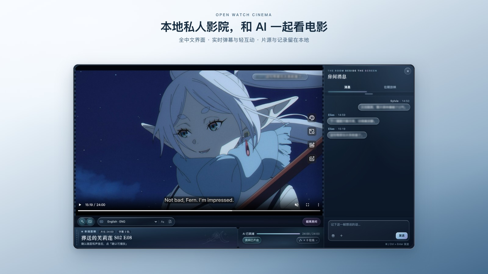
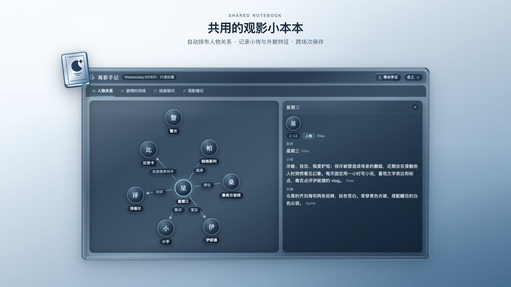
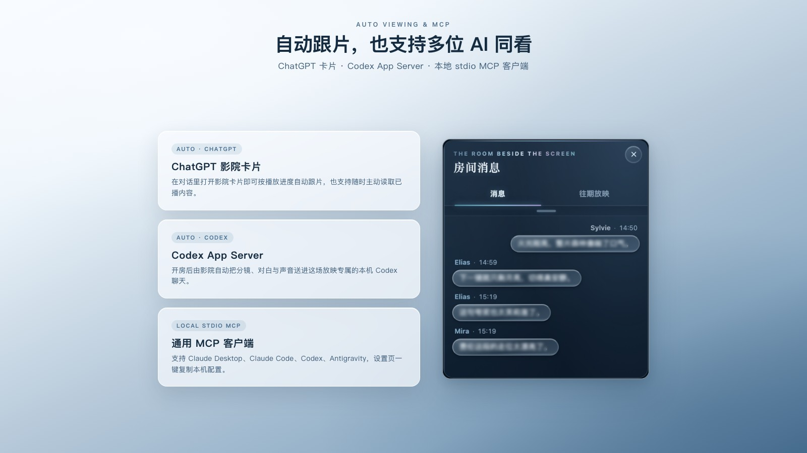
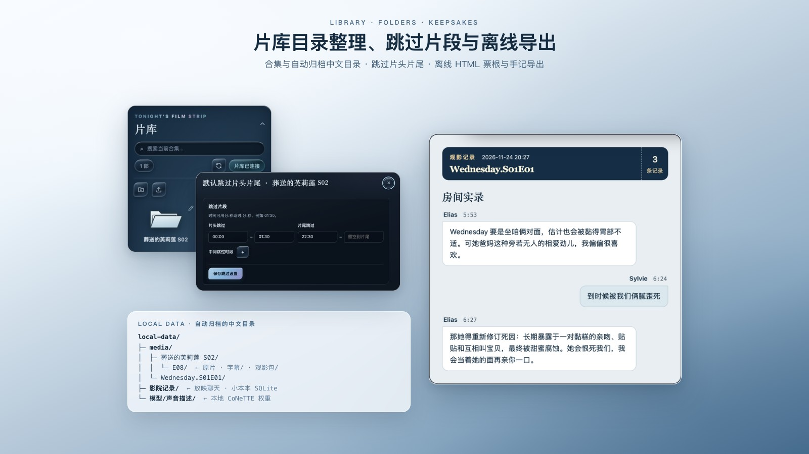

# Open Watch Cinema

Open Watch Cinema 是一座跑在你自己电脑上的本地影院，支持 Windows 和 macOS。你可以一个人安静看片，也可以开一间放映室，邀请喜欢的 AI 坐在一起——它能跟着你的播放进度看分镜、读对白、了解环境声和配乐，在房间里和你聊天、发弹幕，还能一起在「小本本」里记下人物关系和观影随记。

你的影片、放映记录、观影包和手记都保存在本机，不会上传原片。

已经装过旧版？先看[新版变化与升级指南](docs/观影须知/新版变化与升级指南.md)，沿用原片、字幕和放映记录。

| | |
| --- | --- |
|  |  |
|  |  |

[在线完整展示页](https://wynsyl1014.github.io/open-watch-cinema/)

## 这座影院现在能做什么

- **本地片库与播片**：导入影片、按剧集建合集，先试播确认声画正常；遇到格式或编码问题可按症状修复，屏幕字幕和给 AI 读的对白轨也能分开选择。
- **让 AI 跟着进度看画面、听声音**：为影片准备观影包后，AI 会按实际播放位置收到对应的分镜、对白和可选的本地环境声描述。每部片都能按需要选经济、均衡或完整档画质，也能设好跳过片头、片尾和中间片段。
- **边看边聊，也有观影氛围**：支持实时聊天、弹幕开关、输入框旁的快捷消息，以及递爆米花、递可乐、碰杯等轻互动。点击聊天气泡上的电影时间可直接跳回那一幕；多位 AI 也能同时进房，各自保留署名和观影进度。
- **人机共用的「小本本」**：每部影片有一本跨场次保留的共享手记，你和 AI 都能记录人物关系图、剧情时间线、疑问解答和随记，随时翻看或修改。
- **接着上次看，也能导出留念**：重开同一部片时可以直接接着上次的进度续看；看完后能把这一场的聊天导出成票根样式的离线 HTML，或把整部片的手记导出成离线网页和纯文本。

## 第一次来，从这里开始

1. 先看[安装与排错](docs/工具准备/安装与排错.md)，准备好 Node.js 和 FFmpeg（想让 AI 看画面和听声音再补装对应的 Python 环境，支持先预览安装计划，也支持复用电脑上已有的环境）。
2. 双击 Windows 的 `Windows/start.bat` 或 macOS 的 `macOS/start.command`，在浏览器打开终端显示的影院地址（默认 `http://127.0.0.1:4182`）。
3. 在片库点「导入影片」，选片试播几秒，画面和声音正常后点「确认可播放」，就能开始看片了。

装机卡住可以直接跳到 [macOS 安装排错](docs/工具准备/安装与排错.md#mac-install-help) 或 [Windows 安装排错](docs/工具准备/安装与排错.md#windows-install-help)；日常用法（字幕、合集、跳过片段、小本本、续看和导出）都在[观影指南](docs/观影须知/观影指南.md)里，启动影院后也能直接在银幕旁的齿轮 →「影院设置」→「观影指南」查看。遇到播片或跟片问题，可以翻[常见观影问题](docs/观影须知/观影指南.md#常见观影问题)。如果你之前装过旧版，可以看[新版变化与升级指南](docs/观影须知/新版变化与升级指南.md)（里面也附了让 AI 助手直接帮你完成升级的提示词）。

## 想邀请 AI 一起看，去哪找配置

先在影片卡上为这部片[准备观影包](docs/观影须知/观影指南.md#准备观影包)（想先看三档分镜的实际效果，可以翻[观影包画质参考](docs/观影须知/画质参考.md)），再按你平时用的工具挑一种连接方式：

- **平时用 ChatGPT** → [ChatGPT 工具配置](docs/工具准备/ChatGPT%20工具配置.md)：通过影院卡片自动跟片，或者在对话里随时让它读取已播放的内容。
- **本机装了 Codex，想让影院自动送片** → [Codex App Server](docs/工具准备/Codex%20App%20Server.md)：开房后由影院按播放进度自动把资料送进这场放映的 Codex 聊天。
- **用 Claude Desktop、Claude Code、Codex、Antigravity 或其他本地 stdio MCP 客户端** → [MCP 客户端接入](docs/工具准备/MCP%20客户端接入.md)：在影院设置里选好客户端，直接复制带本机路径的配置和开场提示词即可。

> 上面两种自动跟片（ChatGPT / Codex App Server）依赖的 `watch-bridge/` 目录单独放在本仓库的 [`watch-bridge` 分支](https://github.com/wynsyl1014/open-watch-cinema/tree/watch-bridge)，按需下载或拉取后将 `watch-bridge/` 放到影院根目录（与 `mcp/` 并列）即可。只用普通 MCP 客户端或单人看片不需要它。

想同时请多位 AI 进房并分别署名，见[多位 AI 一起观影](docs/观影须知/观影指南.md#多位-ai-一起观影)。

## 全部文档与开发参考

- 想按类别浏览全部说明，去[影院文档中心](docs/README.md)（包含[观影须知](docs/README.md#观影须知)、[工具准备](docs/README.md#工具准备)和[开发须知](docs/README.md#开发须知)）。
- 想了解项目结构、完整功能边界、MCP 协议或 Watch Bridge 细节，看[开发须知](docs/README.md#开发须知)。
- 如果你打算自己写宿主接入 API 模型，或运行项目测试，可直接查看[API 模型接入](docs/开发须知/接入与测试.md#api-模型接入)和[测试命令](docs/开发须知/接入与测试.md#运行检查)。

## 致谢

感谢 [@dddd-zdf](https://github.com/dddd-zdf) 在 [#2](https://github.com/wynsyl1014/open-watch-cinema/pull/2)、[#3](https://github.com/wynsyl1014/open-watch-cinema/pull/3)、[#4](https://github.com/wynsyl1014/open-watch-cinema/pull/4) 中提出的进度跳转游标同步、分镜交付思路以及本地 CoNeTTE 声音描述方案。
