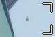
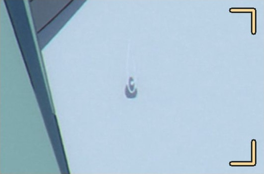
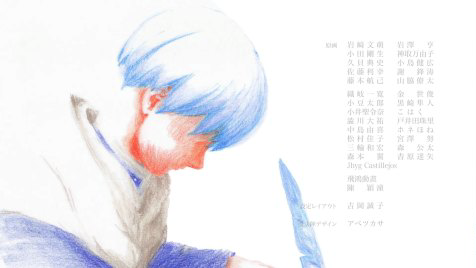
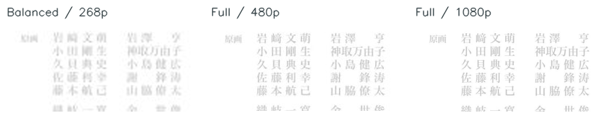

# 观影包画质参考

准备观影包时，每部影片可以选一个档位。档位决定 AI 跟片时收到的分镜，影院银幕始终播放片源视频。

| 档位 | AI 收到的画面 | 适合看什么 |
| --- | --- | --- |
| **经济** | 把选中的时刻按顺序拼成小全景，每格 221 × 124 像素。 | 用较少的图像 token 跟上切镜、人物站位和大动作。 |
| **均衡（默认）** | 全景最大 476 × 268 像素。画面里只有一小处变化时，按全景中的像素尺度展示那一块，并留出周围背景。 | 跟清剧情，也能看出嘴形变了、脸上多了一滴汗。 |
| **完整** | 每个全景独立成图，可选 480p、720p 或 1080p。同一处局部变化与均衡共用原片裁框，用更多像素展示。 | 细看汗滴的轮廓和高光，或读片尾浅灰色姓名里挨得很近的笔画。 |

## 《葬送的芙莉莲》第 8 集，同一滴汗

第二季第 8 集 **14:59.500**，镜头停在人物的侧脸上。到 **15:00.000**，脸颊上多了一滴汗。这组分镜在做包时就把稍后的汗滴嵌进侧脸全景的右上角。播放到点，AI 收到整张画中画。下面单独展示两档的小窗，方便对照。两张都取自 **15:00.000 的同一帧**，四条裁边完全一致，左侧都保留了同一缕头发。

**均衡 · 81 × 54 像素**。脸颊中央多了一小点，结合刚看过的侧脸，已经能跟上出汗这个变化。

**完整（1080p）· 525 × 347 像素**。看同一滴汗，现在能分清下缘的深色轮廓和中间弯起的一线亮光。

打开实际交付的成品，可以看到小窗贴在右上角。均衡把先前的月亮和人物侧脸拼在一张图里，完整档给侧脸独立一张全景。脸颊原位和右上小窗带有相同角标。均衡图注为 `14:58.5 · 14:59.5 → 15:00`，其中前一个时刻是月亮；完整侧脸图的图注为 `14:59.5 → 15:00`。[均衡成品 · 952 × 268](images/storyboard-quality/frieren-sweat-balanced-storyboard.jpg) · [完整档的侧脸成品 · 1920 × 1080](images/storyboard-quality/frieren-sweat-full-1080-storyboard.jpg)

## 《葬送的芙莉莲》片尾，同一帧能读到什么

第二季第 8 集 **22:34.000**，人物低着头，白底上的原画署名是很淡的灰字。先看均衡档实际交付的这一格，大小为 476 × 268 像素。刘海遮住眼睛、脸颊的红色和右侧一行行姓名都看得出来。

再看当时留存的截图。三栏截取同一帧右侧的同一块署名，按相同宽度并排显示。均衡已经能认出「小田」「佐藤」这样的一部分字。到 480p，更容易顺着一行读完整个人名。1080p 的提升集中在笔画密的字上。这个镜头里，看懂人物和片尾内容用均衡就够，想核对演职员姓名时才特别用得上完整档。

上图保留了初次对照时的截图，当时的完整档使用固定三格。下表链接到现行各档同一时刻的全景。经济和均衡从各自交付的拼图中按原像素取出第一格，完整档直接使用该时刻交付的 JPEG。

| 档位 | 这帧的实际大小 | 画面里的差别 |
| --- | --- | --- |
| [经济](images/storyboard-quality/frieren-economy.png) | 221 × 124 | 低头的姿态、发色和片尾排版清楚，右侧小字很难逐字读。 |
| [均衡](images/storyboard-quality/frieren-balanced.png) | 476 × 268 | 能看出署名的大概，认出部分姓名用字，细笔画挨得比较近。 |
| [完整 480p](images/storyboard-quality/frieren-full-480.jpg) | 853 × 480 | 「小田剛生」「佐藤利幸」更容易连起来读。 |
| [完整 720p](images/storyboard-quality/frieren-full-720.jpg) | 1280 × 720 | 浅灰字的轮廓更清楚，姓名中较密的笔画也更容易分开。 |
| [完整 1080p](images/storyboard-quality/frieren-full-1080.jpg) | 1920 × 1080 | 放大核对单字时，细笔画之间仍留有清楚的空隙。 |

## 全景、画中画与单独的局部

三个档位都按动作选择时刻。遇到相似画面时，会在这段时间内按每秒 8 帧回看原片，寻找一闪而过的变化。完整档还会用更高分辨率核对准备略过的近似画面，有机会留下缩小后很难察觉的细节。

均衡和完整第一次交代场景时，可以把稍后发生的局部变化贴在全景的空处。完整档的小窗通常把局部放大到它在本档全景中约 1.6 倍的边长，空间紧张时会试较小的放大幅度。小窗容易挡住文字、人脸或动作，或本机缺少影院的人脸检测模型时，两档都会把局部紧接在全景后单独送出。

做包时，影院在全景原位和对应局部画上成对角标，单发局部也能对回前面的全景。开场讲一次读图约定，此后图注只列时间，箭头指向变化时刻。制包时沿着影片顺序去重，决定每张成品是全景、画中画还是独立局部。跟片工具 `tick` 按播放进度顺序读取成品文件；同一观影包里的一张图，每个 AI 收到的内容都一样。

三个档位都保存成品分镜。全景保持片源比例，480p、720p 和 1080p 表示全景的目标上限，低分辨率片源的全景按原尺寸交付。局部可以放大显示，能够辨认的细节取决于片源。单图超过体积预算时会先调整 JPEG 质量，完整档仍超限时会尝试较低的全景档位。以前准备的包沿用原有图片和细看能力，重新准备后使用当前规则。

## 图片 token 怎么比

估算时看 AI 实际收到的每张成品图的宽高。上例的汗滴已经嵌在全景里，按整张成品计算一次；另一段如果在制包时把局部存成独立图，就按那张局部图的宽高单独计算。片中动作多少、分镜数量、模型及 detail 设置都会影响整集结果。[OpenAI 图像输入计算规则](https://developers.openai.com/api/docs/guides/images-vision)

采用共用裁框之前，这集片尾 **22:34 至 22:35** 的一组分镜按 GPT-6 Astra 的 `detail: high` 规则估算，经济和均衡各有一张五格拼图，约 **168、810** 个图像输入 token。完整档当时交付五张全景，480p、720p、1080p 分别约 **2,430、5,520、12,240** 个。同期对这集 24 分钟动画的整集估算为经济 **3.97 万**、均衡 **17.58 万**、完整 480p **54.46 万**，完整 1080p 只抽查了五组。这些数字来自当时的观影包。[影院实验记录](../开发须知/实验记录.md)
